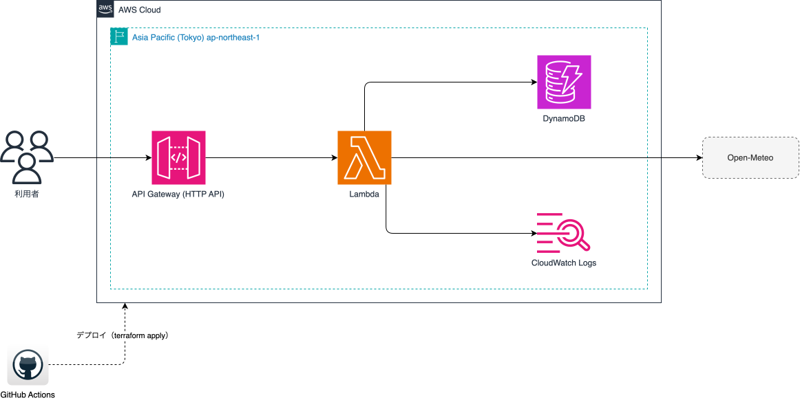
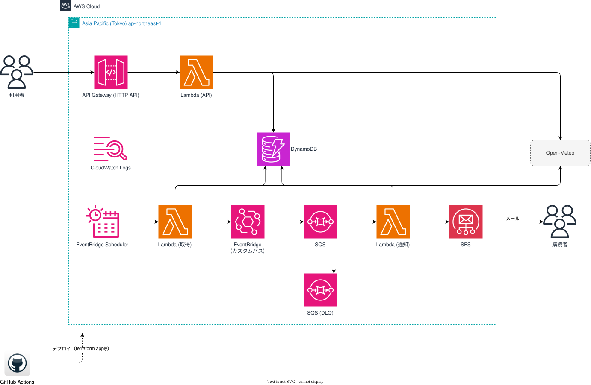

# tempestas

地域と日付を指定すると、その日の天気予報を返す API です。Go と AWS Lambda で作り、インフラはすべて Terraform で管理しています。フロントエンドはありません。

> [!NOTE]
> 開発中です。最小構成を先に本番環境までデプロイし、そこに中身を足していく「ウォーキングスケルトン」の進め方をとっています。現在は、固定の JSON を返す Lambda を dev 環境にデプロイした段階です。

## 構成図

### MVP



MVP は `GET /weather` だけを提供します。予報は Open-Meteo から取得し、DynamoDB にキャッシュします。

### 想定完成形



次のフェーズで、購読者に毎朝天気を通知する仕組みを追加します（[今後の拡張](#今後の拡張)）。

図の元データは `docs/*.drawio` です。

## API 仕様

仕様は [`api/openapi.yaml`](api/openapi.yaml) にまとめています。エンドポイントやレスポンスを変えるときは、先にこのファイルを更新します。

Swagger UI でも確認できます。

```sh
docker compose up -d   # http://localhost:8081
```

## 技術選定と設計判断

### Lambda と API Gateway（HTTP API）

<!-- Step 7 で、Lambda を選んだ理由を追記する -->

- API Gateway は、REST API ではなく HTTP API を使います。このサービスに必要なのは Lambda との統合とスロットリングだけで、REST API にしかない機能（API キー、リクエストの検証、WAF との直接の連携など）は使わないためです。
- Lambda は `provided.al2023` / arm64 で動かします。

### 地域を緯度経度ではなく地域コードで受け付ける

対応する地域を、固定のリスト（`sapporo`、`tokyo`、`nagoya`、`osaka`、`fukuoka`）にしています。地域を値オブジェクトとしてドメインの中に閉じ込め、入力のバリデーションをドメインで行うためです。

### レイヤー構成

<!-- Step 3〜4 で、ドメイン・ユースケース・アダプタの実装に合わせて追記する -->

依存の向きを `adapter → usecase → domain` にしたクリーンアーキテクチャ風の構成です。

- Lambda（`cmd/api`）とローカルのサーバー（`cmd/local`）は、同じ `http.Handler` を使います。Lambda 専用の処理をハンドラに入れないことで、ローカルでも本番と同じコードを動かせます。
- 予報を取得するユースケース（`GetWeather`）は、キャッシュを先に見て、なければ Open-Meteo から取得して保存します。次のフェーズで追加する取得 Lambda も、同じユースケースを使います。

### DynamoDB によるキャッシュ

<!-- Step 4〜5 で、DynamoDB を選んだ理由、キー設計、TTL を追記する -->

### コストの上限

- API Gateway のステージにスロットリング（毎秒 5 件、バースト 10 件）を設定しています。上限は全クライアントで共有します。目的は、請求額と Open-Meteo への負荷に上限を設けることです。
- AWS WAF は使っていません。HTTP API には直接付けられず、使わなくても固定費がかかるためです。
- AWS Budgets のアラートは、アカウント全体の安全装置として、Terraform ではなくマネジメントコンソールで設定しています。

### ビルドの再現性

- ビルドは Docker の開発用コンテナ（Go 1.27.3）の中で行います。ホストの環境に左右されません。
- 中身が同じなら zip のハッシュも同じになるようにしています。ビルドし直しても、Terraform が変更のない Lambda を更新しません。

### Terraform

- state は S3 に置き、`use_lockfile` でロックします（DynamoDB のロックテーブルは使いません）。
- 作るリソースには、すべて `Project = tempestas` のタグを付けます。

### CI/CD

<!-- Step 6 で、GitHub Actions のワークフローと OIDC による認証を追記する -->

## ディレクトリ構成

<!-- 実装が進んだら更新する -->

```
.
├── api/openapi.yaml      # API 仕様
├── cmd/api/              # Lambda のエントリポイント
├── internal/
│   └── adapter/handler/  # HTTP ハンドラ
├── docker/app/           # 開発用コンテナ
├── docs/                 # 構成図
└── terraform/
    ├── bootstrap/        # state 用の S3 バケット
    └── envs/dev/         # dev 環境（API Gateway、Lambda など）
```

## ローカルでの開発

必要なもの：Docker、make、Terraform 1.17

ビルド・テスト・lint は、Docker の開発用コンテナの中で行います。

## デプロイ

AWS への認証は IAM Identity Center（SSO）で行います。

state 用の S3 バケットは、`terraform/bootstrap` で作成済みです。別の AWS アカウントで作り直す場合は、`terraform/bootstrap/versions.tf` の `backend "s3"` をいったん外して `apply` し、作られたバケット名を `backend` に書き戻してから `terraform init -migrate-state` で state を S3 に移します。`terraform/envs/dev/versions.tf` の `backend` も、同じバケット名に書き換えます。

<!-- Step 6 で、main へのマージ時に GitHub Actions がデプロイすることを追記する -->

## 今後の拡張

次のフェーズで、購読者に毎朝天気を通知する仕組みを追加します（[想定完成形の構成図](#想定完成形)）。

- 購読の登録・解除 API（`POST /subscriptions`、`DELETE /subscriptions/{id}`）
- EventBridge Scheduler が毎朝取得 Lambda を起動し、購読されている地域の予報を地域ごとに1回だけ取得する
- 購読者ごとのメッセージを SQS（DLQ 付き）に送り、通知 Lambda が SES や Slack で通知する
- 購読 ID と日付を冪等キーにして、二重送信を防ぐ
